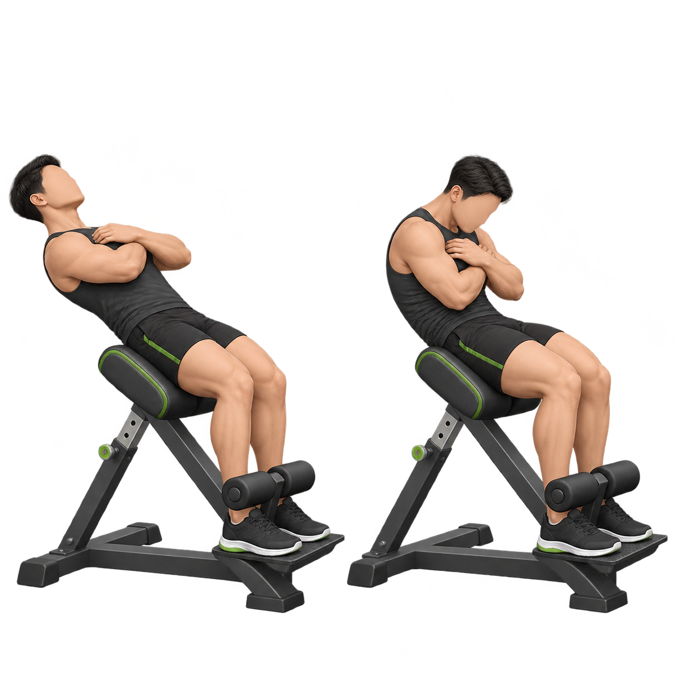

# 凯圣王 × 谭成义三分化：openGym 动作映射

配套导入文件：[tanchengyi-three-split.zh-CN.json](tanchengyi-three-split.zh-CN.json)。在 openGym 的“计划”页面点击右上角分享按钮，再选择“导入计划文件”。文件新增推、拉、腿和腹部四条训练日，不会覆盖已有计划，也没有预设星期安排。

这份映射依据公开的 2026 三分化及腹部动作清单整理。推、拉、腿的 15 个动作和腹部训练中的 2 个动作已存在于 openGym 目录，因此会自动使用相应 ID 的静态图和动画。`反向山羊挺身卷腹` 与内置 `3329` 接近，但现有授权图不能覆盖；导入文件把它保存为自定义动作，以便使用更准确的原创示范图。

## 动作映射

| 训练日 | 跟练动作 | openGym 动作 | ID | 媒体 |
|---|---|---|---|---|
| 推 | 杠铃卧推 | barbell bench press | `0025` | `catalogue/media/still/0025.webp`、`catalogue/media/clip/0025.mp4` |
| 推 | 哑铃上斜卧推 | dumbbell incline bench press | `0314` | `catalogue/media/still/0314.webp`、`catalogue/media/clip/0314.mp4` |
| 推 | 双杠臂屈伸 | chest dip | `0251` | `catalogue/media/still/0251.webp`、`catalogue/media/clip/0251.mp4` |
| 推 | 仰卧臂屈伸（肩屈位） | barbell lying triceps extension | `0061` | `catalogue/media/still/0061.webp`、`catalogue/media/clip/0061.mp4` |
| 推 | Y 字侧平举 | weighted full can exercise | `5818` | `catalogue/media/still/5818.webp`、`catalogue/media/clip/5818.mp4` |
| 拉 | 单手钢线下拉 | cable one arm lat pulldown | `1204` | `catalogue/media/still/1204.webp`、`catalogue/media/clip/1204.mp4` |
| 拉 | 对握下拉 | cable neutral grip lat pulldown | `7583` | `catalogue/media/still/7583.webp`、`catalogue/media/clip/7583.mp4` |
| 拉 | 单手器械划船 | lever one arm seated row | `1235` | `catalogue/media/still/1235.webp`、`catalogue/media/clip/1235.mp4` |
| 拉 | 坐姿开肘划船 | cable seated wide-grip row | `0218` | `catalogue/media/still/0218.webp`、`catalogue/media/clip/0218.mp4` |
| 拉 | 钢线弯举（肩屈位） | cable overhead curl | `1636` | `catalogue/media/still/1636.webp`、`catalogue/media/clip/1636.mp4` |
| 腿 | 单腿硬拉 | dumbbell single leg deadlift | `1757` | `catalogue/media/still/1757.webp`、`catalogue/media/clip/1757.mp4` |
| 腿 | 保加利亚分腿蹲 | dumbbell bulgarian split squat | `2290` | `catalogue/media/still/2290.webp`、`catalogue/media/clip/2290.mp4` |
| 腿 | 颈前深蹲 | barbell front squat | `0042` | `catalogue/media/still/0042.webp`、`catalogue/media/clip/0042.mp4` |
| 腿 | 罗马尼亚硬拉 | barbell romanian deadlift | `0085` | `catalogue/media/still/0085.webp`、`catalogue/media/clip/0085.mp4` |
| 腿 | 山羊挺身 | hyperextension | `0489` | `catalogue/media/still/0489.webp`、`catalogue/media/clip/0489.mp4` |
| 腹部 | 反向山羊挺身卷腹 | 自定义动作（参考 roman chair sit up） | `ctcy-reverse-roman-chair-crunch`（参考 `3329`） | 导入后手动上传下方原创图 |
| 腹部 | 悬挂举腿 | hanging leg raise | `0472` | `catalogue/media/still/0472.webp`、`catalogue/media/clip/0472.mp4` |
| 腹部 | 跪姿龙门架卷腹 | cable kneeling crunch | `0175` | `catalogue/media/still/0175.webp`、`catalogue/media/clip/0175.mp4` |

`Y 字侧平举` 是名称上最容易产生歧义的一项。当前映射选用持轻重量、拇指向上、沿肩胛面举成 Y 字的 `5818`。若原视频实际使用龙门架，可改为 `8899`（cable standing y raise v. 2）；若动作更接近普通哑铃满罐侧平举，可改为 `0311`。

## 反向山羊挺身卷腹图片



这张图是全新生成的原创示意图，没有读取或改写 `catalogue/media/still/3329.webp`。导入计划后，在动作库中打开“反向山羊挺身卷腹”→“编辑自定义动作”，上传 [PNG 原图](media/tanchengyi-reverse-roman-chair-crunch.png) 即可。之所以不直接替换 `3329`，是因为目录媒体有独立许可，而且 `3329` 的动作名仍是较宽泛的“罗马椅仰卧起坐”；自定义版本可保留谭成义动作更具体的名称、提示和图片。

## 新增动作的两种格式

### 个人自定义动作

在应用的动作库中选择“创建自己的动作”。必填项是名称、身体部位和器械；主肌群、辅助肌群、描述、图片/GIF/视频及教学链接均可选。图片会在设备端处理，长边最多保存为 1600px，处理后的图片上限默认 2MB；GIF 默认上限 8MB；MP4、MOV 或 WebM 视频默认上限 40MB、60 秒。服务端可以调整这些上限。

自定义动作保存后的核心数据形状如下，ID 由应用生成，不需要手写：

```json
{
  "id": "c...",
  "n": "动作名称",
  "bp": "back",
  "eq": "cable",
  "desc": "动作提示",
  "tg": "lats",
  "primaries": ["lats"],
  "secondaries": ["biceps"],
  "muscleGroups": ["lats", "biceps"],
  "custom": true
}
```

### 内置目录动作

内置动作写在 `catalogue/exercises/<id>.json`，英文名称使用小写，ID 是永久的 4 或 5 位数字。枚举值必须来自 `scripts/catalogue/validate.mjs`。描述写一到两句，动作说明使用 4 到 7 条简短的第二人称步骤。示例：

```json
{
  "id": "12345",
  "name": "cable example movement",
  "bodyPart": "back",
  "equipment": "cable",
  "target": "lats",
  "secondaryMuscles": ["biceps", "upper back"],
  "category": "strength",
  "description": "A short, original description of the movement and what it trains.",
  "instructions": [
    "Set the cable and take a stable starting position.",
    "Brace your core and begin the pull with control.",
    "Finish the movement without leaning or swinging.",
    "Return slowly to the starting position."
  ]
}
```

中文翻译另写入 `catalogue/i18n/zh.json`，以动作 ID 为键。完成后运行：

```sh
node scripts/catalogue/validate.mjs
node scripts/catalogue/build.mjs
node scripts/catalogue/check-media.mjs
```

仓库现有 `catalogue/media` 属于单独授权内容，项目规则明确禁止复制、修改、替换或输入 AI 工具。若以后确实出现目录没有的新动作，应先确认媒体授权方案；个人使用时优先走“自定义动作”，上传自己拍摄或自己拥有权利的图片或短视频。

## 资料来源

- [凯圣王 × 谭成义三分化训练计划（整理项目）](https://github.com/Jmdyy/KaishengwangXTanchengyi)
- [谭成义三分化训练计划（动作与组次整理）](https://github.com/Brave-Maker/tanchengyi-fitness/blob/main/references/three-split.md)
- [反向山羊挺身卷腹公开示范](https://www.youtube.com/watch?v=jkY6id0i9z0)
- [openGym 动作目录贡献规则](../../catalogue/README.md)

训练组次是公开资料的结构化整理，动作提示为适配 openGym 的简短改写。请根据自身训练水平、器械条件和恢复状态调整，并在不适或疼痛时停止。
